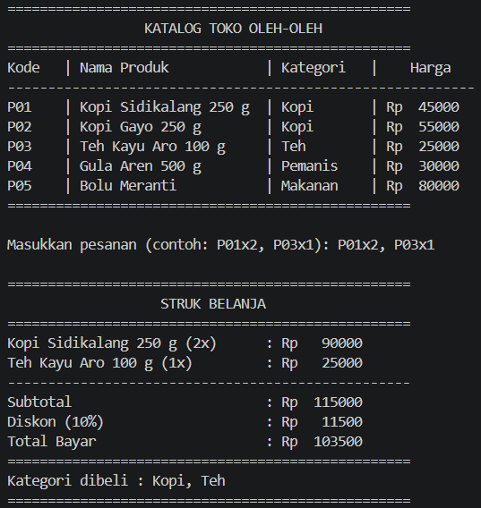

# Tugas Rutin 2 - Pemrograman Mobile (Dart)

* **Nama:** [Nama Lengkap Anda]
* **NIM:** 4242250002
* **Mata Kuliah:** Pemrograman Mobile

## Deskripsi Program
Aplikasi console berbasis Dart ini dirancang untuk mensimulasikan sistem kasir toko oleh-oleh khas Medan. Program menampilkan katalog produk, memproses input pesanan dari pengguna dengan format tertentu, menghitung subtotal, memberikan diskon otomatis sebesar 10% jika total belanja mencapai syarat tertentu, serta menampilkan struk belanja secara akurat lengkap dengan penanganan kesalahan (*error handling*) untuk kode produk yang tidak valid.

## Tangkapan Layar (Screenshot)
1. **Skenario Pesanan Valid:**
   
2. **Skenario Pesanan Kode Salah (Error Handling):**
   

## Penjelasan Konsep Dart
1. **`var` vs `final` vs `const`:**
   * `var`: Digunakan untuk mendeklarasikan variabel yang tipe datanya dapat disimpulkan secara otomatis oleh Dart (*type inference*), dan nilainya **dapat diubah** setelah diinisialisasi.
   * `final`: Digunakan untuk variabel yang nilainya **hanya dapat diatur sekali** (saat runtime) dan tidak dapat diubah lagi setelahnya.
   * `const`: Mirip dengan `final`, tetapi nilainya **sudah harus diketahui dan tetap sejak waktu kompilasi (*compile-time*)**, sehingga lebih efisien untuk nilai yang benar-benar konstan/tetap.

2. **Peran *Null Safety*:**
   * *Null safety* pada Dart memastikan bahwa variabel secara *default* tidak boleh bernilai `null` kecuali jika kita secara eksplisit mendeklarasikannya menggunakan tanda tanya (contoh: `String?`). Hal ini sangat membantu mencegah terjadinya *error* runtime yang umum terjadi seperti *NullReferenceException* atau *crash* mendadak pada aplikasi, sehingga kode menjadi jauh lebih aman dan stabil.

## Pernyataan Penggunaan AI
Dalam pengerjaan tugas rutin ini, AI digunakan sebagai teman diskusi dan panduan penulisan struktur kode serta penyusunan dokumentasi.

   